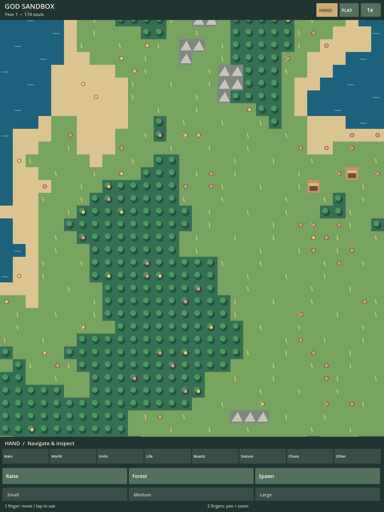
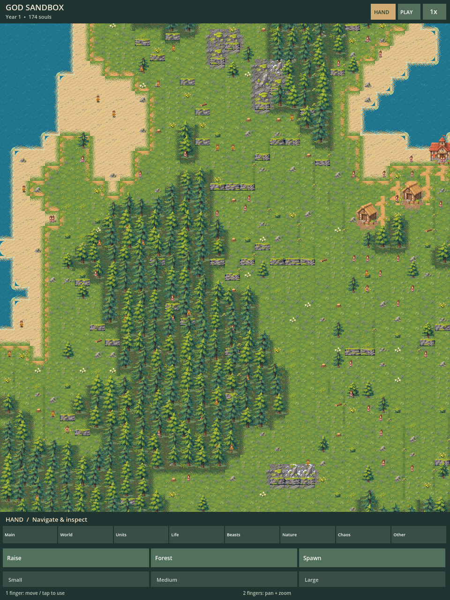

# Phase 1 pixel-art overhaul

Implemented on `dev/phase1-pixel-art`; main remains unchanged. Godot 4.5.2, GDScript, Android arm64, GL Compatibility.

## Actual gameplay comparison

Both captures use procedural seed 424242, simulation tick 1050, the same camera and zoom. These are Godot GL Compatibility viewport captures, not the generated source sheet. The baseline required an explicit String type annotation to parse under 4.5.2; its visual behaviour was unchanged.

Before:

After:

[Wider world capture](captures/after-medium.png)

## Implemented systems

- 32×32 terrain, nearest filtering and 231 named reusable regions. A single 1024×1024 runtime atlas batches terrain, cliffs, foliage, buildings and citizen sprites. Three separate authoring atlases and exact region metadata remain available.
- Separate cached canvas command layers for water, ground, transitions, elevation, ground details, depth-sorted vegetation/buildings and units; bounded water highlights and power effects; brush/UI stay independent. No node per tree or terrain cell.
- 16×16 chunks with visible-chunk culling, edit invalidation and a cardinal/diagonal one-cell halo. Static scenery is retained between frames. Distant chunks bake into small cached textures, avoiding thousands of repeated sprite calls. Three zoom detail levels suppress small decorations and thin distant trees.
- Four meadow/forest/dirt/ash variants, packed settlement earth, deep/shallow water, sand, rocks and mountain tops. Neighbour-mask biome edges, shore corners, rounded coastal silhouettes and connected dirt paths update after procedural generation and manual painting.
- Visual elevation strata (0–3), south-facing rock layers, directional edge shading, inner/outer joins and contact shadows. Tree/building/unit anchors and brush picking use raised surfaces. This does not introduce vertical physics, elevation-based walkability or new fluid simulation.
- Five deterministic pine variants, bushes, grasses, flowers, logs, stumps and rocks. Huts, cottages, workshops and town halls derive from simulated towns/capitals. Terrain edits remove associated visuals. Two original citizen sprites replace dots.
- Original procedural terrain, fixed-step simulation, six powers, population rules, speed/pause, drag brushes and touch gestures remain. Old version-1 saves load without elevation; new saves keep the version and add optional heights. RNG state now serialises as a string to avoid losing 64-bit precision through JSON.

## Asset files

| File | Purpose |
| --- | --- |
| `assets/icon.svg` | Original app icon used by Android export |
| `assets/pixel/sprite_atlas.png` | Single runtime atlas |
| `assets/pixel/terrain.png` | 37 named terrain regions |
| `assets/pixel/objects.png` | 50 transparent sprite regions |
| `assets/pixel/transitions.png` | 144 transparent masks/edges/path/shadow regions |
| `assets/pixel/atlas.json` | Local and packed rectangles for every region |
| `tools/source/source_sheet.png` | Selected image-generated source |
| `tools/build_pixel_assets.py` | Reproducible authoring packer |

[Full asset region inventory](../assets/pixel/README.md) · [Art provenance and authoring](art-source.md)

## Validation

| Check | Result |
| --- | --- |
| Godot 4.5.2 headless project import | Passed, no script/resource errors |
| Existing simulation tests | 15 checks passed |
| Rendering / terrain / saves | 306 assertions passed |
| Synthetic touch and controls | 26 assertions passed |
| Main-scene headless smoke | 90 frames, no errors |
| GL Compatibility viewport capture | Passed under Mesa llvmpipe |
| Physical Huawei P30 | Pending |

Rendering tests cover every atlas rectangle, all 16 shoreline/biome neighbour masks, corner dirtying, culling, cached scenery, all zoom levels, raised tile picking at fractional zoom, disk JSON save/load, legacy saves, deterministic continuation, all six power effects and renderer isolation from simulation RNG. Input tests cover continuous fast drag, pinch/pan, no paint during two-finger gestures or after one finger lifts, hand navigation, mode switches and pause/speed controls.

## Measured desktop performance

Godot 4.5.2, Linux Xvfb, 480×850 viewport, Mesa llvmpipe CPU-rendered OpenGL. VSync is unavailable in this test. Each case warms 40 frames and samples 180 frames. These short desktop measurements do not establish Android FPS, GPU memory, thermal stability or long-run behaviour.

| Zoom | Citizens | Visible chunks | Mean FPS | Frame p95 | Draw calls |
| --- | ---: | ---: | ---: | ---: | ---: |
| 0.5× | 160 | 36 | 259.8 | 5.87 ms | 74 |
| 1.0× | 160 | 16 | 141.7 | 12.50 ms | 38 |
| 2.0× | 160 | 4 | 201.4 | 7.65 ms | 38 |
| 1.0× | 1500 | 16 | 131.0 | 12.36 ms | 38 |

No static terrain rebuild occurred during the cached-view samples. A single edit and synchronous dirty-chunk rebuild measured 24.47 ms, so painting can still produce frame spikes. Godot tracked roughly 39–42 MiB of static CPU allocations; that is not total process/GPU memory. The widest view dropped from 1,280 draw calls before caching to 74; the unified atlas dropped the normal view from 530 to 38. Raw results: [benchmark.json](benchmark.json).

## Remaining limits

- This is a cohesive first woodland/coast biome, not visual parity with every feature in the references. The coastline still follows the simulation grid, with pixel transitions and rounded corners. Mountains are low rock outcrops/terraces rather than large illustrated peaks.
- Elevation is visual; old saves receive flat defaults except mountains. There is no vertical pathfinding, waterfall or fluid-physics extension.
- Bridges and several extra settlement props are delivered assets; automatic bridge placement and bridge simulation are not implemented. There is no character walk animation yet.
- Distant cached scenery favours readability and draw-call reduction; units draw over distant static canopies and chunk overlap can look simpler than close depth sorting. First-time zoom changes and brush rebuilds can hitch.
- Physical Android launch, device GPU compatibility, multi-minute FPS/memory/thermal testing and background/relaunch saves need the [Huawei P30 checklist](huawei-p30-checklist.md).
- The existing workflow produces a newly debug-signed APK on each run. Android may require uninstalling the previous build, which removes local app data. Production signing is outside this phase.

## Android workflow

The stricter export check caught the original project’s missing app-icon configuration on the first CI export. An original SVG app icon is now configured, and paused spawn/fire sprite refresh plus burned-capital rendering have additional regression coverage.

The existing Android workflow now runs the simulation, rendering and input suites, rejects script errors even if Godot returns exit code zero, captures actual GL gameplay and exports the APK. It runs on main or this dedicated development branch. No main merge is required. APK and validation captures are retained as workflow artifacts for 14 days. Build status and exact artifact are reported with the delivery.
